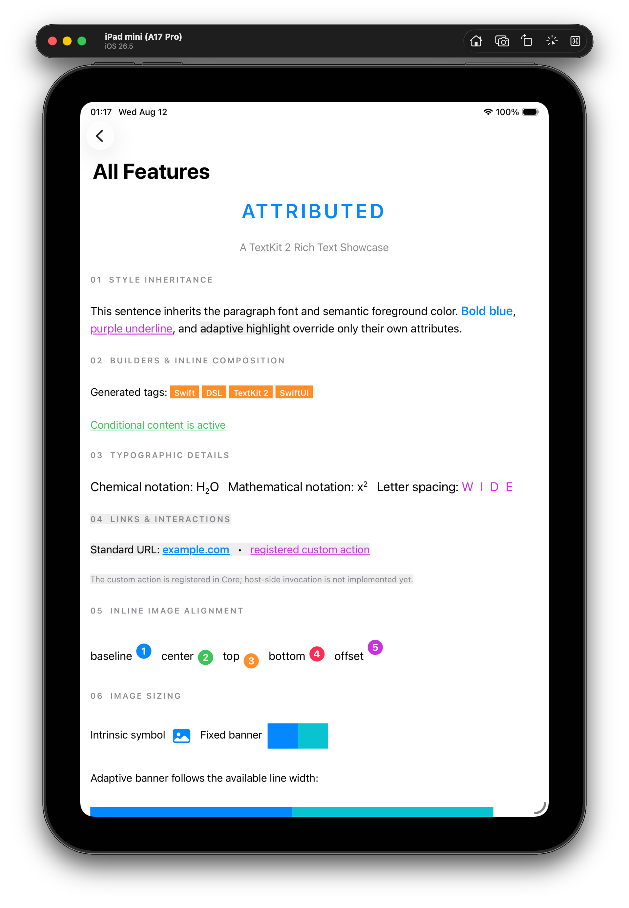

# Attributed

> [!WARNING]
> 🚧 **Under Development** — The current API is an early v0.1 design and may change before the first stable release.

Attributed is a TextKit-first Swift DSL for building `NSAttributedString` with composable paragraphs, inline styles, links, and explicit attribute inheritance. It supports iOS and macOS and bridges the same TextKit rendering into SwiftUI.

<p align="center">
  
</p>

## Requirements

- Swift 5.9 or later
- iOS 16 or later
- macOS 13 or later

## Installation

Add the package in Xcode using:

```text
https://github.com/weirui-kong/Attributed.git
```

Or add it to `Package.swift`:

```swift
dependencies: [
    .package(
        url: "https://github.com/weirui-kong/Attributed.git",
        branch: "main"
    )
]
```

Then add the `Attributed` product to your target:

```swift
.target(
    name: "YourTarget",
    dependencies: [
        .product(name: "Attributed", package: "Attributed")
    ]
)
```

## Usage

```swift
import Attributed
import Foundation

let document = AAttributedText {
    AParagraph {
        "Hello "

        AText("Attributed")
            .font(.boldSystemFont(ofSize: 20))
            .foregroundColor(.systemBlue)
            .underline()

        "! Visit "

        ALink(
            "the project",
            url: URL(string: "https://github.com/weirui-kong/Attributed")!
        )
        .foregroundColor(.systemBlue)
        .underline()
    }
    .font(.systemFont(ofSize: 16))
    .lineSpacing(4)
    .paragraphSpacing(8)
}

let rendered = document.render()
let attributedString = rendered.attributedString
```

Paragraph attributes are inherited by inline nodes. An inline node overrides only the attributes explicitly applied to it.

Result builders support raw strings, conditionals, and loops:

```swift
AAttributedText {
    AParagraph {
        "Tags: "

        for tag in tags {
            AText("[\(tag)] ")
                .foregroundColor(.systemOrange)
        }

        if isActive {
            AText("ACTIVE")
                .font(.boldSystemFont(ofSize: 12))
        }
    }
}
```

Inline images use the same paragraph builder:

```swift
AParagraph {
    "Status "

    AImage(statusImage, accessibilityLabel: "Online")
        .size(.fixed(width: 18, height: 18))
        .alignment(.center)
}
```

Remote images require an injected provider. `AttributedUtility` includes a simple URLSession implementation:

```swift
import AttributedUtility

ARemoteImageEnvironment.provider = ImageDownloader()

let image = AImage(
    remoteURL: imageURL,
    placeholder: placeholder
)
.size(.adaptive(maxWidth: 320, maxHeight: 240))
```

## Display

UIKit and AppKit can use the TextKit-backed host directly:

```swift
import Attributed

let rendered = document.render()
let textView = ATextKitView()
textView.display(rendered)
```

SwiftUI uses a platform bridge around that same host:

```swift
import Attributed
import SwiftUI

ATextView(document)
```

The bridge uses TextKit 2 on every supported platform and provides image attachment rendering and layout invalidation. The `A`-prefixed facade avoids collisions with `SwiftUI.Text`, `SwiftUI.Link`, and `SwiftUI.Image`.

Custom interaction handling and custom-view attachments will extend these host adapters as those features are implemented.

## Modules

| Module | Purpose |
| --- | --- |
| `Attributed` | Primary facade containing the `A`-prefixed public aliases. |
| `AttributedCore` | DSL nodes, attribute inheritance, rendering, and interaction state. |
| `AttributedTextKit` | UIKit and AppKit text hosts and attachment integration. |
| `AttributedSwiftUI` | SwiftUI bridges backed by the TextKit host. |
| `AttributedUtility` | Optional and replaceable integrations such as remote image loading. |

Most applications should depend only on `Attributed`.

## Current Features

- Paragraph and inline node grammar
- Immutable text and paragraph modifiers
- Font, foreground and background color, kern, baseline offset, and underline attributes
- Alignment, writing direction, line spacing, and paragraph spacing
- Raw strings, conditionals, and loops in result builders
- URL links and custom interaction registration
- Synchronous and asynchronous image attachments
- Fixed, intrinsic, and adaptive image sizing
- Injectable remote image provider with independently configurable memory and temporary disk caches
- iOS and macOS support

## Planned

- Custom-view attachment providers
- Additional image loading and cache policies

## Demo

The example app is located in [`Demo/AttributedDemo`](Demo/AttributedDemo). It includes visual test pages for long text, mixed inline styles, paragraph layout, links, and left-to-right and right-to-left content.

## Documentation

Design specifications, API notes, and guides live in [`docs`](docs).

## License

Attributed is available under the MIT License. See [`LICENSE`](LICENSE) for details.
