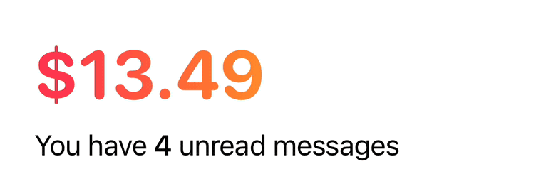
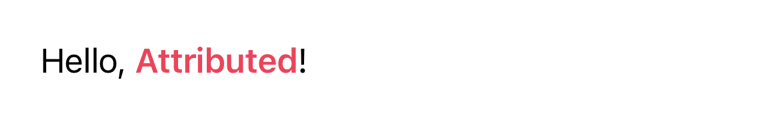
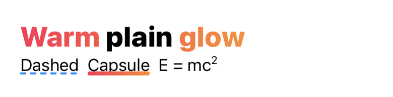
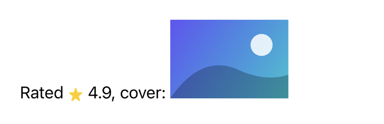
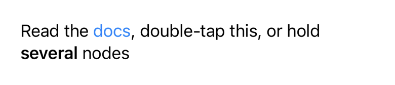
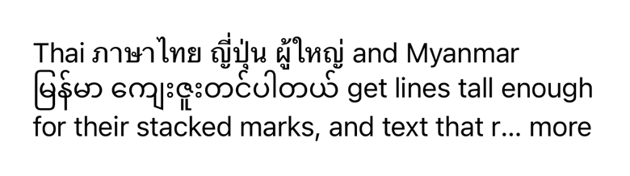
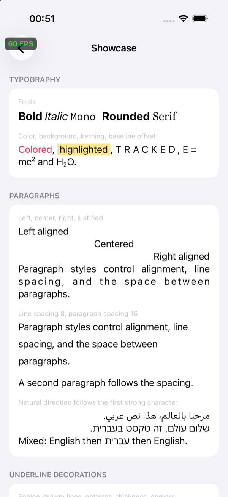
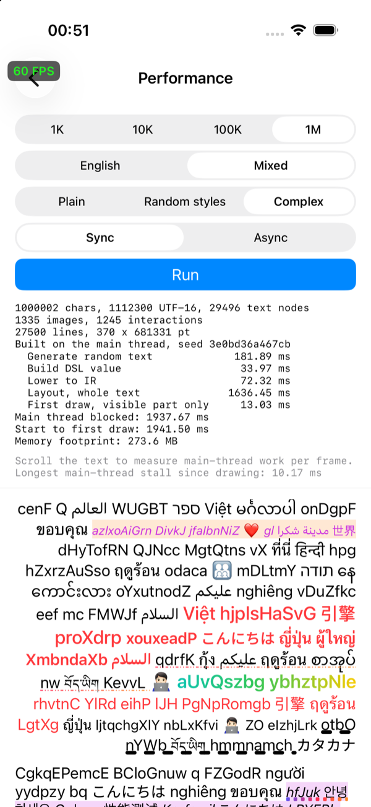

# Attributed

> [!WARNING]
> 🚧 **Under Development** — The API is still changing and has no stable release yet.

Attributed builds rich text with a Swift DSL and displays it in its own text view, laid out and drawn directly on CoreText by an Objective-C++/C++ engine. It doesn't use TextKit and never exposes `NSAttributedString`.

<picture>
  <source media="(prefers-color-scheme: dark)" srcset="docs/images/readme/transition-dark.gif">
  
</picture>

- **Display only (currently!)**, like a read-only `UITextView`: taps, multi-taps, and long presses on any part of the text, with no editing or selection yet.
- **Engine-drawn styling**: gradient text joined across runs, underlines with patterns, thickness, rounded corners, and gradient fills.
- **Images inline**, given up front or loaded after the text appears.
- **Complex scripts**: Arabic and Hebrew, plus line height that can grow to fit the stacked marks of Thai, Myanmar, and Tibetan.
- **Text transitions**: SwiftUI's numeric text transition on iOS, drawn with Metal, for prices and counters.
- **Long text**: layout on any thread, viewport tiling, and hit views only near the screen. In the demo, 1M characters of mixed scripts and styles scroll at full frame rate.

## Examples

Every node and modifier below is pure Swift. `ATR`-prefixed names are aliases of the types in the `Attributed` namespace.

### Text and paragraphs

```swift
import Attributed

let textView = ATRTextView()
textView.text = ATRAttributedText {
    ATRParagraph {
        "Hello, "
        ATRText("Attributed")
            .font(.boldSystemFont(ofSize: 17))
            .foregroundColor(.systemPink)
        "!"
    }
    .font(.systemFont(ofSize: 17))
    .lineSpacing(4)
}
```

<picture>
  <source media="(prefers-color-scheme: dark)" srcset="docs/images/readme/text-dark.png">
  
</picture>

### Gradients and underlines

```swift
let sunset = ATRTextGradient(colors: [.systemPink, .systemOrange])

ATRAttributedText {
    ATRParagraph {
        ATRText("Warm")
            .gradient(sunset)
        " plain "
        ATRText("glow")
            .gradient(sunset)   // joined with "Warm" into one continuous gradient
    }
    .font(.systemFont(ofSize: 28, weight: .heavy))

    ATRParagraph {
        ATRText("Dashed")
            .underline(ATRUnderlineStyle(pattern: .dash, thickness: 2), color: .systemBlue)
        "  "
        ATRText("Capsule")
            .underline(ATRUnderlineStyle(thickness: 4, corners: .capsule), gradient: sunset)
        "  E = mc"
        ATRText("2")
            .font(.systemFont(ofSize: 11))
            .baselineOffset(7)
    }
}
```

<picture>
  <source media="(prefers-color-scheme: dark)" srcset="docs/images/readme/gradients-dark.png">
  
</picture>

A gradient's scope (`.line`, `.paragraph` by default, or `.document`) decides which equal gradients are drawn as one.

### Images

```swift
ATRParagraph {
    "Rated "
    ATRImage(.resolved(star), size: .fixed(width: 16, height: 16))
        .alignment(.center)
    " 4.9, cover: "
    ATRImage(.defer { loadCover() }, size: .fixed(width: 120, height: 80))   // loaded after the text appears
}
```

<picture>
  <source media="(prefers-color-scheme: dark)" srcset="docs/images/readme/images-dark.png">
  
</picture>

### Interactions

```swift
ATRParagraph {
    "Read the "
    ATRText("docs")
        .foregroundColor(.systemBlue)
        .link(docsURL)
    ", double-tap "
    ATRText("this")
        .onTap(count: 2, value: 42)
    ", or hold "
    ATRGroup<any ATRInline> {
        ATRText("several ")
            .font(.boldSystemFont(ofSize: 17))
        ATRText("nodes")
    }
    .onLongPress(minimumDuration: 0.5) { print("held") }
}
```

<picture>
  <source media="(prefers-color-scheme: dark)" srcset="docs/images/readme/interactions-dark.png">
  
</picture>

The text view's delegate receives every recognized gesture with its value, text range, text, location, and rects:

```swift
func textView(_ textView: ATRTextView, didRecognize event: ATRInteractionEvent) {
    if let number = event.value(as: Int.self) {
        print(number, event.range, event.text, event.rects)
    }
}
```

### Text view options

Shown with a long Thai and Myanmar paragraph:

```swift
textView.maximumNumberOfLines = 3
textView.truncationToken = "… more"
textView.lineHeightMode = .glyphBounds          // lines grow to fit tall glyphs
textView.isViewportRenderingEnabled = true      // draw only tiles near the enclosing scroll view's viewport
```

<picture>
  <source media="(prefers-color-scheme: dark)" srcset="docs/images/readme/options-dark.png">
  
</picture>

### Text transitions

SwiftUI's numeric text transition, on iOS: changed digits roll behind a blur, and kept glyphs slide to their new places. The animation at the top of this page is this call.

```swift
textView.setText(price, transition: .numericText(.upward)) { outcome in
    print(outcome)   // .finished, .superseded, .interrupted, or .skipped
}
```

### Layout off the main thread

```swift
Task.detached {
    let prepared = text.prepare(in: ATRTextContainer(width: width))
    await MainActor.run { textView.setText(prepared) }   // applied synchronously, no second layout
}

// Measuring without a view:
let layout = text
    .lower()
    .layout(in: ATRTextContainer(width: 320, maximumNumberOfLines: 2))
layout.size; layout.lineCount; layout.isTruncated
```

## Demo

[`Demo/AttributedDemo`](Demo/AttributedDemo) is a UIKit app:

- **Showcase**: every feature, mixed styles, and multilingual text.
- **Transitions**: the numeric text transition above SwiftUI's own, for comparison.
- **Performance**: up to 1M characters in one text view, timed stage by stage.
- **Stress**: random view lifecycles and background layout, checked for hangs.

<p>
  
  
</p>

## Requirements

iOS 15+ or macOS 13+, Swift 6. See [`Package.swift`](Package.swift). Building needs Xcode's Metal Toolchain for the text transition shader:

```bash
xcodebuild -downloadComponent MetalToolchain
```

## Documentation

| Document | Contents |
| --- | --- |
| [Overview](docs/README.md) | Documentation map and accuracy policy |
| [Goals and constraints](docs/design/goals-and-constraints.md) | Scope, hard constraints, naming, conventions |
| [Architecture](docs/design/architecture.md) | Layers, targets, language boundary, verification |
| [DSL](docs/design/dsl.md) | Nodes and modifiers: text, underlines, groups, interactions, images, gradients |
| [IR](docs/design/ir.md) | Op stream, styles, resources, invariants, dump format |
| [Layout and rendering](docs/design/layout-and-rendering.md) | Layout pipeline, drawing, the text view, tiling, gestures |
| [Text transitions](docs/design/text-transitions.md) | Numeric text transition: glyph atoms, host, effect, comparison with SwiftUI |
| [Roadmap](docs/design/roadmap.md) | Progress checklist |
| [Decisions](docs/design/decisions.md) | Decision log and open questions |

## License

MIT. See [`LICENSE`](LICENSE).
